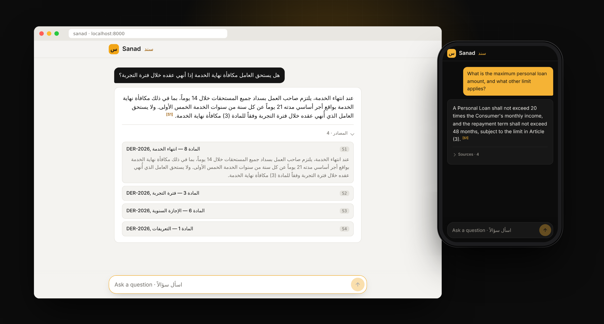
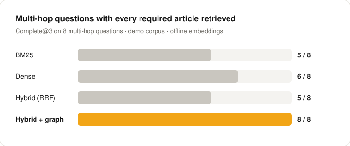
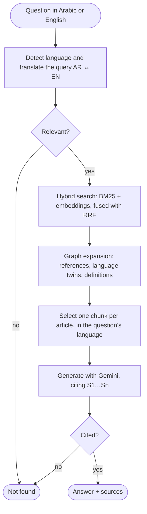

<div align="center">


# Sanad · سند

**Bilingual Arabic–English GraphRAG over regulations.**<br>
Ask in either language. Get an answer in yours, cited to the exact article.

[](https://github.com/valentinakiyungi/sanad/actions/workflows/ci.yml)


<!-- After deploying, replace this line with: **[Live demo →](https://your-app.onrender.com)** -->
[Results](#results) · [How it works](#how-it-works) · [Quick start](#quick-start) · [Deploy](#deploy)



</div>

> *Sanad* (سند) means "support" and, in Arabic scholarship, the chain of sources behind a statement. Every answer here comes with its chain.

## Overview

Regulation in the Gulf is bilingual, and its answers rarely sit in one place. A worker asks in Arabic whether they get an end-of-service gratuity after leaving during probation. The rule is in Article 8, which says it applies "subject to Article (3)" — so a correct answer needs both articles, possibly from an English source.

Sanad handles this with three ideas:

- **Arabic-aware search.** Spelling variants are unified (alef and hamza forms, taa marbuta, diacritics, tatweel) and attached prefixes such as "wa-" and "al-" are stripped before keyword search, which is then fused with embeddings.
- **A legal knowledge graph.** Cross-references, definitions and the Arabic/English versions of each article are linked, so retrieval follows "subject to Article (3)" the way a lawyer would.
- **Grounded answers only.** Citations are checked against what was actually retrieved, and questions with no relevant article get an explicit "not found" instead of a guess.

## Results



Full ablation on 25 hand-written questions (single-hop, multi-hop and definitions; 12 in Arabic). Reproduce with `python -m sanad eval`; CI re-runs it on every push.

| Retrieval mode | Recall@3 | Complete@3 | Complete@3 (multi-hop) | MRR | Recall@3 (Arabic) |
|---|:---:|:---:|:---:|:---:|:---:|
| BM25 | 0.94 | 0.88 | 0.62 | 0.97 | 0.88 |
| Dense | 0.96 | 0.92 | 0.75 | 0.97 | 1.00 |
| Hybrid (RRF) | 0.94 | 0.88 | 0.62 | 0.97 | 0.92 |
| **Hybrid + graph** | **1.00** | **1.00** | **1.00** | **1.00** | **1.00** |

*Complete@3* counts a question only if **every** required article is in the top 3 — a half-retrieved multi-hop answer is a wrong answer.

> [!NOTE]
> **How to read these numbers.** The corpus is small (2 regulations, 16 articles, 32 chunks), the questions were written by hand, and the graph-expansion rule was designed with this set in view. The table shows what each component *contributes*, not an accuracy you should expect on real legislation. The offline run uses a hashing embedder that cannot match Arabic to English; with a Gemini key, `python -m sanad eval` uses multilingual embeddings instead.

## How it works



The pipeline is a **LangGraph** `StateGraph`. The same node functions also run on a tiny sequential runner, so the test suite needs no extra dependencies.

<details>
<summary><b>The knowledge graph</b></summary>

<br>

Built with NetworkX from the corpus at index time, and exportable to Neo4j (`scripts/export_neo4j.py`).

| Node | Example | Edges |
|---|---|---|
| Law | `law:DER-2026` | `CONTAINS` → its articles |
| Article | `article:DER-2026:8` — holds both the Arabic and English text | `REFERENCES` → `article:DER-2026:3` |
| Term | `term:الاجر`, `term:wage` | `DEFINES` / `MENTIONS` ← articles |

References are extracted from both languages ("subject to Article (8)", "وفقاً للمادة (8)", "المادتين (3) و(4)") and match exactly across them.

</details>

<details>
<summary><b>Why graph expansion ranks references directly after the best match</b></summary>

<br>

Reciprocal rank fusion compresses scores: rank 2 is about 0.98 × rank 1. Multiplying a referenced article's score by a fixed factor therefore never lifts it into the top results. Instead, articles referenced by the best match are placed directly after it, references of the next two seeds get a smaller boost, and definition questions ("ما معنى…", "what does … mean") route to the defining article.

</details>

<details>
<summary><b>Relevance gate and citation validation</b></summary>

<br>

Before the LLM is called, a cheap gate checks for a keyword match or a strong embedding match. On the demo set every real question passes and nonsense ("HRDCGNBVMN", "what is the capital of France?") scores zero. After generation, every `[S1]`-style marker is checked against the sources actually provided; invented ones are removed, and an answer with no valid citation becomes an explicit "not found" in the question's language.

</details>

## Features

| Feature | What it does |
|---|---|
| **Bilingual by design** | Ask in Arabic or English; answers come back in the question's language, citing the article version in that language |
| **Multi-hop retrieval** | Follows "subject to Article (n)" references through the knowledge graph |
| **Verified citations** | Answers cite `[S1]…[Sn]`; markers that don't match a retrieved source are stripped |
| **Honest "not found"** | Off-topic questions are stopped before the LLM call |
| **Runs offline** | No key needed: hash embeddings and an extractive mock LLM for tests, CI and demos |
| **Clean web app** | Mobile-first chat UI, right-to-left aware, light and dark themes |
| **Production basics** | FastAPI, Docker, health checks, per-visitor rate limiting, retries with backoff |

## Tech stack

| Layer | Tools |
|---|---|
| Orchestration | LangGraph |
| LLM & embeddings | Google Gemini (`gemini-3.5-flash-lite`, `gemini-embedding-001`) via REST, standard library only |
| Retrieval | Custom Arabic-aware BM25, NumPy dense search, reciprocal rank fusion |
| Knowledge graph | NetworkX, Neo4j Cypher export |
| Service | FastAPI, Uvicorn, Docker, Render |
| Quality | pytest, Ruff, GitHub Actions |

## Quick start

```bash
git clone https://github.com/valentinakiyungi/sanad.git && cd sanad
python3 -m venv .venv && source .venv/bin/activate
pip install -e ".[api,pdf,dev]"

python -m sanad index                  # build the index and knowledge graph
uvicorn sanad.api:app --reload         # open http://localhost:8000
```

This runs fully offline. For real generated answers, add a free key from [Google AI Studio](https://aistudio.google.com/apikey):

```bash
cp .env.example .env                   # paste your key after GEMINI_API_KEY=
python -m sanad check                  # verifies generation and embeddings
python -m sanad index                  # rebuild with Gemini embeddings
```

<details>
<summary><b>Command line</b></summary>

<br>

```bash
python -m sanad ask "هل يستحق العامل مكافأة نهاية الخدمة إذا أنهي عقده خلال فترة التجربة؟" --trace
python -m sanad ask "What is the maximum personal loan amount?" --json
python -m sanad eval --out eval/results.md
```

`--trace` prints each pipeline step with its timing.

</details>

<details>
<summary><b>Docker</b></summary>

<br>

```bash
docker compose up --build              # http://localhost:8000
```

`.env` is read if present; without it the container runs offline.

</details>

<details>
<summary><b>API</b></summary>

<br>

```bash
curl -X POST localhost:8000/api/ask -H 'Content-Type: application/json' \
  -d '{"question": "What is the maximum personal loan amount?"}'
```

The response contains the answer, validated citations, every retrieved source with *how* it was found (`bm25`, `dense`, `graph:references`, `graph:language-twin`, …), the rewritten queries and per-step timings. An optional `mode` (`bm25`, `dense`, `hybrid`, `graph`) switches retrieval. `GET /api/health` reports the index, model and graph statistics; interactive docs are at `/docs`.

</details>

## Deploy

The repo includes a `render.yaml` blueprint for Render's free tier.

1. Sign in at [render.com](https://render.com) with GitHub, choose **New + → Blueprint**, and pick this repo.
2. Paste your `GEMINI_API_KEY` when asked. It is stored in Render, never in the repo.
3. Wait about 3 minutes for the build. The index is built at startup, and `/api/health` turns green when it's ready.

Each visitor can ask 10 questions a minute (`SANAD_RATE_LIMIT_PER_MIN`) to protect the Gemini quota. Free instances sleep when idle, so the first visit can take up to a minute.

## Use real legislation

The demo corpus is **fictional** and marked as such in every file, so the project ships without redistributing anything. To index real law:

1. Download official texts in Arabic and English, for example from the UAE Legislation portal (uaelegislation.gov.ae).
2. Save them as `<law-id>.<lang>.<ext>` in one folder, e.g. `labour-law.ar.pdf` and `labour-law.en.pdf`.
3. Run `python -m sanad index --corpus data/raw`, add your own questions to `eval/gold.jsonl`, and run `python -m sanad eval`.

Articles are detected from headers like `Article (5)`, `Article 5`, `المادة (5)` and `مادة ٥`. Arabic text extracted from PDFs is often imperfect, so check a few chunks after indexing and prefer HTML or text sources.

## Testing

```bash
pytest -q                              # 43 tests: Arabic text, corpus, graph, retrieval, pipeline, API, CLI
ruff check . && ruff format --check .
```

CI runs lint, tests and the retrieval evaluation on Python 3.11 and 3.12, then builds the Docker image and smoke-tests an Arabic question against it.

## Project structure

```
sanad/
├── arabic.py        Arabic normalisation, tokeniser, light stemmer
├── corpus.py        Article-aware chunking, reference and definition extraction
├── bm25.py          BM25 over the Arabic-aware tokeniser
├── embeddings.py    Gemini embeddings and offline hashing embedder
├── kg.py            Legal knowledge graph
├── retrieval.py     Hybrid search, RRF, graph expansion, relevance gate
├── pipeline.py      LangGraph pipeline and sequential runner
├── llm.py           Gemini REST client with retries, offline mock
├── prompts.py       Prompt templates
├── evaluation.py    Retrieval ablation metrics
├── api.py           FastAPI service
└── static/          Web app and icons
data/demo/           Fictional bilingual regulations
eval/gold.jsonl      25 evaluation questions
scripts/             Neo4j export
tests/               Test suite
```

## Roadmap

- [ ] Score answer faithfulness (LLM-as-judge) on a held-out question set, alongside retrieval
- [ ] Link references across laws ("Federal Law No. X"), not only within one regulation
- [ ] Swap NumPy search for pgvector or Qdrant to index full legal codes
- [ ] Serve Falcon-Arabic or Jais through vLLM/Ollama for on-premise deployments — the LLM interface is a single method
- [ ] Calibrate the Gemini relevance threshold (`SANAD_MIN_DENSE`, default 0.65) on a real corpus

## Disclaimer

Sanad is a portfolio and research project. It does not provide legal advice.

## License

MIT © [Valentina Yuda Kiyungi](https://github.com/valentinakiyungi)
