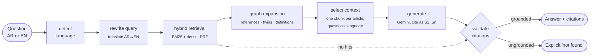

# Sanad · سند

**Bilingual Arabic–English GraphRAG over regulations — every answer cited to the exact article.**

Ask a question in Arabic or English. Sanad finds the relevant articles with hybrid search, follows cross-references through a legal knowledge graph ("subject to Article (8)"), and answers in your language with citations it has checked against the sources it actually retrieved.

[](https://github.com/valentinakiyungi/sanad/actions/workflows/ci.yml)


**Live demo:** _add your Render URL here after deploying (see [Deploy](#deploy-a-live-demo))_

> *Sanad* (سند) means "support" — and, in Arabic scholarship, the chain of sources behind a statement.

---

## Why

Regulation in the Gulf is bilingual. A compliance analyst, HR team or customer may ask in Arabic about a rule they only ever read in English, and the answer often spans two articles: the rule, and the article it says it is "subject to". Plain vector RAG struggles with both:

| Problem | What Sanad does |
|---|---|
| Arabic orthography breaks keyword search (أ/إ/ا, ة/ه, diacritics, attached و/ال/ل) | Arabic normaliser + light stemmer feeding a custom BM25 |
| Answers that need a *referenced* article | Knowledge graph of `REFERENCES` edges; references of the best match are pulled into context |
| Question and source in different languages | Each article is one graph node holding its Arabic and English text ("language twins"), plus LLM query translation |
| Confident answers with invented citations | Citations validated against retrieved sources; ungrounded answers become an explicit "not found" |

## Results

Retrieval ablation on the demo corpus (`python -m sanad eval`, fully offline, reproduced in CI on every push):

| Mode | Recall@3 | Complete@3 (all) | Complete@3 (multi-hop) | MRR | Recall@3 (Arabic) |
|---|---|---|---|---|---|
| bm25 | 0.94 | 0.88 | 0.62 | 0.97 | 0.88 |
| dense | 0.96 | 0.92 | 0.75 | 0.97 | 1.00 |
| hybrid | 0.94 | 0.88 | 0.62 | 0.97 | 0.92 |
| **hybrid + graph** | **1.00** | **1.00** | **1.00** | **1.00** | **1.00** |

*Complete@3* is the strict multi-hop metric: the share of questions where **every** required article is in the top 3. On the 8 multi-hop questions, graph expansion raises it from 0.62 to 1.00.

**Read these numbers honestly.** The corpus is small (2 regulations, 16 articles, 32 chunks), the 25 questions were written by hand, and the expansion rule was designed with this set visible. The point of the table is the *mechanism* — what each component contributes, measured — not a headline accuracy. Expect lower numbers on real legislation; the eval harness is there to measure exactly that (see [Use real legislation](#use-real-legislation)).

The offline run uses a hashing embedder, which cannot match Arabic to English. With `GEMINI_API_KEY` set, `make eval` uses multilingual Gemini embeddings instead.

## How it works



The pipeline is a LangGraph `StateGraph` (with a conditional edge when nothing is retrieved). The same node functions also run with a small sequential runner, so the test suite needs no extra packages.

**Knowledge graph** (`sanad/kg.py`, NetworkX, exportable to Neo4j):

| Node | Edges |
|---|---|
| `law:DER-2026` | `CONTAINS` → articles |
| `article:DER-2026:8` (holds the AR and EN chunk) | `REFERENCES` → `article:DER-2026:3` |
| `term:الاجر` / `term:wage` | `DEFINES` / `MENTIONS` from articles |

**Graph expansion** (`sanad/retrieval.py`): RRF scores are compressed (rank 2 ≈ 0.98 × rank 1), so fixed score multipliers never surface a referenced article. Instead, articles referenced by the best match are ranked directly after it; references of the next two seeds get a smaller boost; definition questions ("ما معنى…", "what does … mean") route to the defining article.

## Quick start

```bash
git clone https://github.com/valentinakiyungi/sanad.git && cd sanad
pip install -e ".[api,pdf,dev]"

python -m sanad index                     # build index + knowledge graph from data/demo
python -m sanad ask "هل يستحق العامل مكافأة نهاية الخدمة إذا أنهي عقده خلال فترة التجربة؟" --trace
python -m sanad eval                      # retrieval ablation table
uvicorn sanad.api:app --reload            # web UI at http://localhost:8000
```

No key needed: without one, Sanad runs offline (hash embeddings + an extractive mock LLM). For real answers:

```bash
cp .env.example .env          # then paste your free key from https://aistudio.google.com/apikey
python -m sanad check         # verifies generation + embeddings, shows Arabic/English similarity
python -m sanad index         # rebuilds the index with Gemini embeddings
python -m sanad eval          # the ablation table, now with multilingual embeddings
```

**Docker:** `docker compose up --build`, then open http://localhost:8000.

### Deploy a live demo

The repo includes a `render.yaml` blueprint for Render's free tier:

1. Sign in at [render.com](https://render.com) with GitHub, then **New + → Blueprint** and pick this repo.
2. Paste your `GEMINI_API_KEY` when asked. It stays in Render, never in the repo.
3. Wait for the build (~3 min). The index is built at startup; `/api/health` turns green when ready.

The demo allows 10 questions per minute per visitor (`SANAD_RATE_LIMIT_PER_MIN`) to protect your Gemini quota. Free instances sleep after inactivity, so the first visit can take ~30–60 s.

### API

```bash
curl -X POST localhost:8000/api/ask -H 'Content-Type: application/json' \
  -d '{"question": "What is the maximum personal loan amount?", "mode": "graph"}'
```

The response includes the answer, validated citations, every source with *how* it was found (`bm25`, `dense`, `graph:references`, `graph:language-twin`, …), the rewritten queries, and per-node timings. `GET /api/health` reports the index, model and graph statistics.

## Use real legislation

The demo corpus is **fictional** (clearly marked in each file) so the project can ship without redistributing anything. To index real law:

1. Download official texts, e.g. from the UAE Legislation portal (uaelegislation.gov.ae), in Arabic and English.
2. Save them as `<law-id>.<lang>.<ext>` in one folder, e.g. `labour-law.ar.pdf`, `labour-law.en.pdf`.
3. `python -m sanad index --corpus data/raw`, then write gold questions in `eval/gold.jsonl` and run `python -m sanad eval`.

Articles are detected by headers like `Article (5)`, `Article 5`, `المادة (5)` or `مادة ٥`. Arabic PDF text extraction is often imperfect (reversed or split words); check a few chunks after indexing, and prefer HTML/text sources where available.

## Project layout

```
sanad/
├── arabic.py       Arabic normalisation, tokeniser, light stemmer
├── corpus.py       Article-aware chunking, cross-reference + definition extraction
├── bm25.py         BM25 over the Arabic-aware tokeniser
├── embeddings.py   Gemini embeddings / offline hashing embedder
├── kg.py           Legal knowledge graph (NetworkX)
├── retrieval.py    Hybrid retrieval, RRF, graph expansion
├── pipeline.py     LangGraph pipeline + sequential runner
├── llm.py          Gemini REST client (stdlib, retries) + mock
├── prompts.py      Prompt templates
├── evaluation.py   Retrieval ablation metrics
├── api.py          FastAPI service
└── static/         Bilingual RTL-aware web UI
data/demo/          Fictional bilingual regulations
eval/gold.jsonl     25 gold questions (single-hop, multi-hop, definitions)
scripts/            Neo4j Cypher export
tests/              40 tests (unit, pipeline, LangGraph, API, CLI)
```

## Limitations and next steps

- **Scale**: in-memory NumPy vectors are fine for thousands of articles; a pgvector or Qdrant backend is the next step for full legal codes.
- **Answer quality eval**: retrieval is measured; answer faithfulness is enforced by citation validation but not yet scored. Next: LLM-as-judge faithfulness with a held-out question set.
- **Off-topic questions**: retrieval always returns its closest articles; abstention relies on the LLM replying `NOT_FOUND` (enforced and tested). The offline mock LLM does not abstain. A calibrated relevance threshold is a planned improvement.
- **Cross-law references** ("Federal Law No. X") are not yet linked; only references within one regulation are.
- **Local Arabic models**: the LLM interface is a single method, so Falcon-Arabic or Jais served through vLLM/Ollama can replace Gemini for on-premise deployments.

## Disclaimer

Sanad is a portfolio and research project. It does not provide legal advice.

## License

MIT © Valentina Yuda Kiyungi
